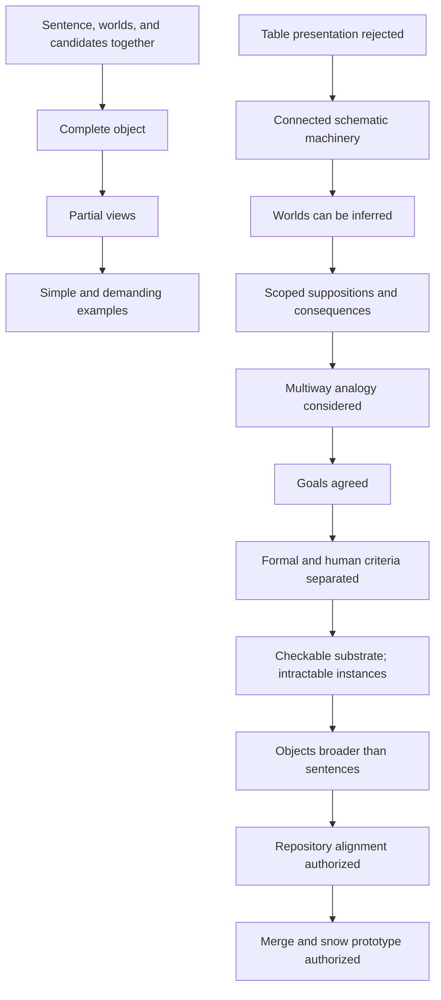

# Inquiry graph and conversation trace

27 October 2026. Curated from the available conversation; evidence below is **paraphrased**, not quoted. This records requirements and their development, not mathematical entailments between conversation turns. No prior inquiry graph was present on main.

The machine-readable source is [inquiry-graph.json](inquiry-graph.json). This provenance graph (a record of where decisions came from) is distinct from the reasoning-object substrate being proposed.

## Main progression

Arrows summarize conversational progression, not implication. The JSON includes typed relations and additional open obligations.

## Trace

| ID | Status | Change and conversational evidence |
| --- | --- | --- |
| Q01 | accepted | **Worlds and candidate values belong with sentence structure.** User rejected the world being absent from 'the world decides' and asked for sentence and suppositional candidates as one thing. |
| Q02 | accepted | **Retain all worlds and suppositions within declared scope.** User wanted all suppositions and worlds in one object, acknowledging that complete displays may become intractable. |
| Q03 | accepted | **Provide coordinated partial views.** User requested viewing subsections of the larger object. |
| Q04 | accepted | **Use simple examples and demanding families.** User requested initial demonstrations and complex examples to test extensibility and formalization; finite examples alone cannot prove generality. |
| Q05 | superseded | **Detached or multiplexed tables are insufficient as the main notation.** User said the displayed chart felt like standard symbolic representation rather than schematic dynamic machinery. |
| Q06 | accepted | **Connected machinery and visible exploration.** User proposed pathways and electronic-circuit-like structure including sentences, worlds, and the process of playing out possibilities. |
| Q07 | accepted | **Worlds are not permanently inputs.** User suggested a statement's truth could select a set of worlds; assistant revised one-way input framing to joint constraints. |
| Q08 | accepted_direction | **Suppositions, propagation, entailment, and branching differ.** User asked how supposing and its entailments fit; assistant distinguished temporary restrictions, local consequences, global entailment, and alternative trials. |
| Q09 | exploratory | **Infinity-groupoid and ruliad.** User offered these terms tentatively. Assistant identified fixed-rule multiway histories as a closer analogy and explained why reversibility and universal computation were not adopted. |
| Q10 | accepted | **Prioritize precise shared objects and inspectable reasoning.** User explicitly agreed with the goals and priorities, then asked whether review concerned human cognition or formal computation. |
| Q11 | accepted_direction | **Separate formal correctness from human intelligibility.** Assistant corrected the conflation: machine checks and proof obligations are separate from Brian's visual review. |
| Q12 | accepted | **Machine-checkable substrate with potentially intractable instances.** User requested formal computationally checkable structure, compact visual explanations of liar/loops/halting, and views relevant to a question. |
| Q13 | proposed | **Question-directed view contracts.** Assistant distinguished restriction, projection, collapse, and abstraction; warned that selecting a useful exact view may itself be difficult. |
| Q14 | accepted | **An object is broader than a sentence.** User clarified that an instance may involve sentences, worlds, facts, suppositional pathways, and true/false values. Assistant adopted typed structured reasoning objects. |
| Q15 | accepted | **Align repository and preserve inquiry trace.** User requested making the repository consistent with this direction and updating the inquiry graph trace. |
| Q16 | accepted | **Merge and prepare the snow prototype.** User approved merging PR #4 and preparing an executable object and connected schematic for review. Unseen visual marks remain unapproved. |
| O01 | open | **Specify executable schema and rule verification.** No general typed schema or context-aware inference checker is implemented by this documentation revision. |
| O02 | open | **Review a connected schematic.** No new gate or pathway notation has been visually approved. |
| O03 | open | **Prove view guarantees within declared scope.** Projection must preserve dependencies and supporting extensions; approximate summaries require explicit guarantees. |
| O04 | open | **Formalize richer self-reference and program behavior.** Strange loops require precise examples; arithmetic and halting need encodings and assumptions beyond predicate labels. |

## Corrections retained

- “World as input” became query-relative roles within joint constraints.
- “Sentence with annotations” became a broader object containing sentence syntax, world conditions, values, contexts, and histories.
- A complete table was useful for checking cases but did not satisfy the schematic visual goal.
- “Review criterion” was split into formal correctness and human intelligibility; Brian is not asked to certify proofs.
- “Machine-checkable” does not imply a universal solver or exhaustive enumeration.
- “Relevant subset” was refined into restriction, projection, collapse, or abstraction, each requiring its own preservation contract.
- Infinity-groupoids and the ruliad remain exploratory analogies. No higher reversible structure or universal-computation ontology is adopted.

## Current decision and next review

The accepted direction is the [project contract](reasoning-objects.md). The exact schema, propagation rules, graphical marks, and view algorithms remain proposals. The next visual review concerns a connected schematic; documentation approval does not imply approval of those still-unseen marks.

PR #2's earlier tutorial and PR #3's finite example suite are separate unmerged work. This trace does not treat them as approved or import their implementations.

## Prototype follow-through

PR #4 merged as `07d54f0`. The [finite snow prototype](snow-prototype.md) provides initial evidence toward O01 and O03. These general obligations remain open; O02 awaits Brian's review of the new schematic.
