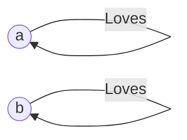
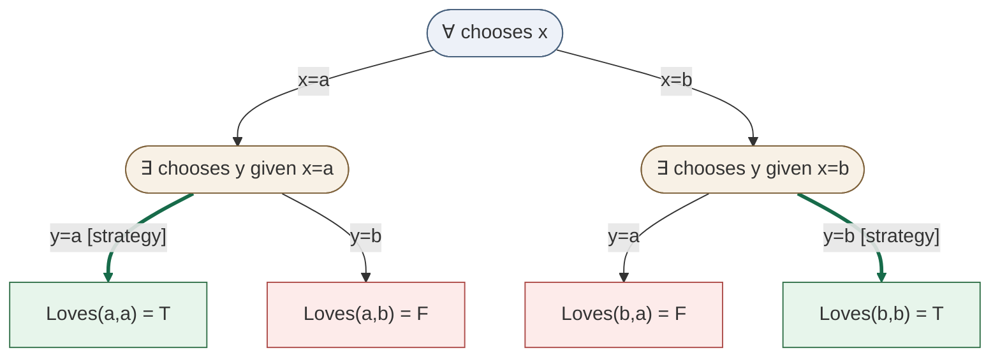
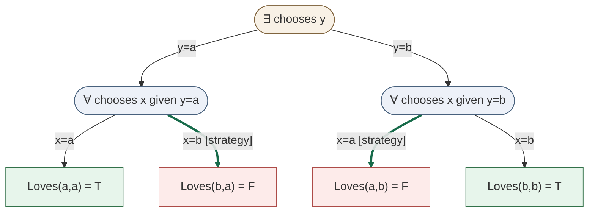

# Two quantifier orders; one fixed world

The **model** is a fixed ordinary structure, not a reasoning branch. Domain
`D={a,b}`; `A` and `B` are *names* whose denotations are `a` and `b`.
`Loves` is the binary relation `{(a,a),(b,b)}`. An edge from a person to
itself means that person loves themself; cross-pairs are absent.

## 1. Every person loves someone: `∀x ∃y Loves(x,y)`

In this **evaluation game**, the Falsifier chooses `x` at `∀`; subsequently
the Verifier chooses `y` at `∃`. A leaf is won by the Verifier iff its
atomic assertion is true in the fixed model. Thick, labelled strategy edges
show how the winning player answers; *all* legal opponent moves remain visible.

The Verifier's winning strategy is `y=x`: choose `a` after `x=a`, and `b`
after `x=b`. The sentence is true in the fixed model.

## 2. Someone is loved by everyone: `∃y ∀x Loves(x,y)`

Now the Verifier must select `y` *before* seeing the Falsifier's `x`.
The Falsifier can always choose a different person, `x≠y`.

The Falsifier's strategy wins against either initial `y`, so the sentence
is false in precisely the same model. Quantifier order changes the allowed
dependencies, not the ordinary world.

## 3. Exact view versus destructive simplification

The joint relation supplies only `(a,a)` and `(b,b)` as witnesses.
Projection onto `x` alone and onto `y` alone each shows `{a,b}`. Multiplying
those unary results creates the **spurious** pairs `(a,b)` and `(b,a)`.
Thus a view hiding one individual must retain the joint relation or its
witness links; two independent value menus do not preserve the answer.

These trees use **standard first-order model-checking game rules**, not new
logical operators. Decision nodes are positions, arrows are legal choices,
and leaves are evaluated facts. Game paths are plays, *not possible worlds*
or completed formal proofs. The source checker independently validates all
strategies and the equivalence with Tarski's quantifier semantics.